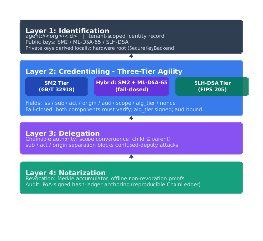
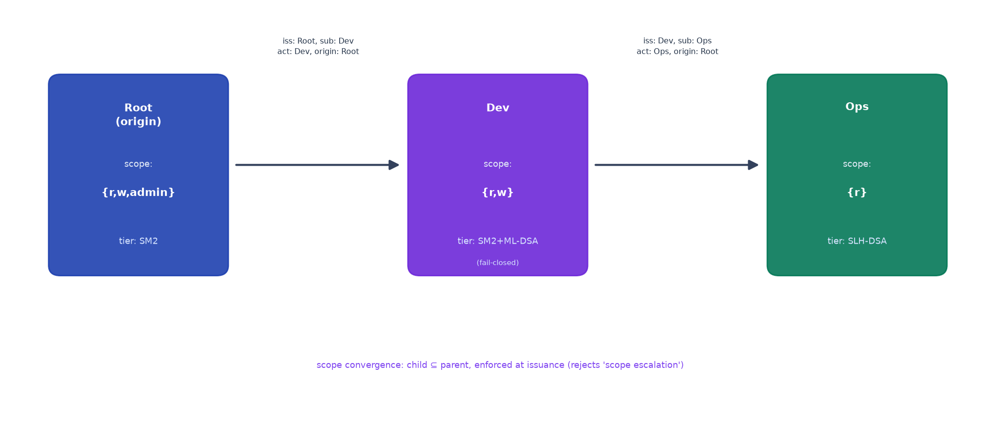
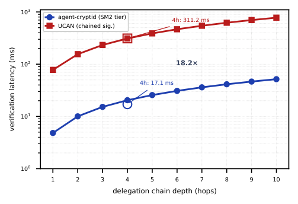
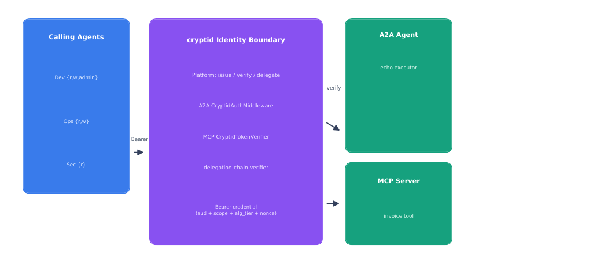

# 面向自主智能体的国密与后量子混合身份中间件设计及验证

**作者**：易海博
**单位**：深圳职业技术大学 人工智能学院，广东 深圳 518055
**邮箱**：haiboyi@szpu.edu.cn
**ORCID**：0000-0002-1635-3738
**基金**：2026年深圳职业技术大学科研项目（No.6026310054K）

## 摘要

针对自主智能体在跨域交互中面临的身份标识不统一、授权委托易被混淆代理攻击、缺乏抗量子能力以及无法离线撤销等突出问题，提出一种国密与后量子混合的身份管理中间件 agent-cryptid。该中间件采用"标识—凭证—委托—存证"四层架构：标识层基于 SM9 无证书公钥，凭证层提供国密 SM2、混合抗量子（SM2+ML-DSA-65，失败关闭）与纯后量子（SLH-DSA）三档签名敏捷，委托层实现作用域收敛与主体/发起方/委托根三字段分离，存证层以 Merkle 累加器实现离线撤销并以签名审计链锚定提供篡改可证。设计上采用控制面与数据面分离、凭证全文不入库、算法档位纳入签名覆盖等机制，抵御降级攻击、跨服务挪用与重放。利用 ProVerif、Tamarin 与 CryptoVerif 完成形式化验证，并给出混合档在随机预言机模型下归约到 ECDLP 与 MLWE 的优势界 2^-128。实验表明：签发 P99 时延 5.13 ms、校验 P50 时延 3.37 ms、10 跳委托链 51.74 ms，均满足非功能指标；14/14 威胁攻击被拒、54/54 已知答案测试通过、官方 A2A TCK 129/129 项一致。最后给出 A2A/MCP 边界的端到端部署与 8/8 攻击拦截结果，证明该中间件可在真实代理协议栈中落地。

**关键词**：自主智能体；身份管理；后量子密码；密码敏捷性；失败关闭安全；形式化验证

## 1 引言

随着大语言模型驱动的自主智能体[1]在工具调用、多步任务编排与跨组织协作中广泛应用，智能体身份与授权成为系统安全的第一道边界。当前主流方案存在四类突出问题。第一，身份标识不统一：X.509 证书[2]、SPIFFE SVID[3]、W3C 可验证凭证[4]与 OAuth2/OIDC[5]各成体系，智能体在 A2A/MCP 等协议栈中难以获得一致的、可跨域验证的身份。第二，授权委托易被混淆代理攻击：现有委托式授权（如 Macaroons[6]、UCAN[7]）以单一字段承载能力令牌，被攻破的下属可诱导委托方在既定根作用域之外行使权限。第三，缺乏抗量子能力：国密 SM2[8]/SM9[9]均受 Shor 算法威胁，现有部署在量子计算机可用后即失效。第四，撤销与审计依赖在线服务：基于证书吊销列表或在线状态的撤销无法离线验证，且缺少对委托历史的可存证审计。

为此，本文提出 agent-cryptid——一个面向自主智能体的国密与后量子混合身份管理中间件[10]。其核心思想是：以"标识—凭证—委托—存证"四层结构，将身份标识、签名凭证、作用域收敛委托与离线撤销/审计锚定解耦为可独立演进的构件；以三档签名敏捷（国密、混合抗量子、纯后量子）在保持与既有国密体系向后兼容的同时引入抗量子能力；以主体（sub）、发起方（act）、委托根（origin）三字段分离从机制上阻断混淆代理升级；以算法档位纳入签名覆盖与受众（aud）字段绑定防止降级与跨服务挪用。

本文的主要贡献包括：（1）提出四层身份中间件架构，并给出可机器验证的设计决策（控制/数据面分离、凭证全文不入库、nonce 原子防重放、算法档位签名覆盖）；（2）构造三档签名敏捷机制并给出混合档在随机预言机（ROM/QROM）模型下归约到 ECDLP 与 MLWE 的优势界；（3）设计作用域收敛委托与基于 Merkle 累加器的离线撤销，并以签名审计链锚定提供篡改可证；（4）构建 19 项实验与三套形式化验证（ProVerif 6/6、Tamarin 5/5、CryptoVerif 3/3），并落实四项先前披露的后续工作为可复现实现。

## 2 相关工作

**传统身份体系。** X.509 证书[2]与 TLS 构成互联网身份基座，SPIFFE 以 SVID[3]支撑微服务身份，二者均以在线证书吊销或短时证书应对撤销。OAuth2/OIDC[5]仍为主流 Web 身份协议，但委托语义依赖令牌交换，易被放大为混淆代理。身份管理综述[10]梳理了物联网与云环境的既有方案。

**委托式授权。** Macaroons[6]以上下文令牌链实现委托，但其验证者须持有根 HMAC 密钥，不具备第三方非对称可验证模式；UCAN[7]以用户控制授权命名实现去中心化委托，但仍以单一字段表达能力，未分离主体与发起方。基于能力的委托研究同样受混淆代理困扰。

**去中心化身份与撤销。** 基于 BBS 签名、零知识证明与动态累加器的方案实现了隐私保护的凭证全生命周期管理；基于 Merkle 累加器的方案可在不暴露成员身份的前提下提供离线非撤销证明。本文以 Merkle 累加器承载撤销、以签名审计链锚定承载审计。

**抗量子身份。** ML-DSA[11]（FIPS 204）与 SLH-DSA[12]（FIPS 205）构成美国后量子标准，国密 SM2[8]/SM3[13]/SM9[9]尚无非对称抗量子替代标准。混合签名（经典+后量子）是过渡期主流实践，但现有混合方案多未做失败关闭语义，也未将算法档位纳入签名覆盖，存在降级风险。

**基准与验证。** X.509 与 VC 基准研究[14][15]为对比提供工程代表值；ProVerif、Tamarin 与 CryptoVerif 已广泛用于协议安全验证，本文将三套工具同时用于一个密码协议族，并给出可证明安全归约，实现"机器可验证+可证明安全"双轨验证。

## 3 系统设计

agent-cryptid 采用四层架构（图1）：标识层、凭证层、委托层、存证层。控制面与数据面分离：身份注册、签发、撤销属控制面，本地校验属数据面，凭证校验完全本地化，不引入在线依赖。

### 3.1 标识层

标识层基于 SM9 无证书公钥[9]，将智能体标识符作为无证书公钥，避免证书管理与密钥托管。每个智能体以 `agent://<org>/<id>` 注册，注册表存储三档公钥。私钥本地派生且不离开智能体进程（硬件根经 SecureKeyBackend 接口实现，软件 HSM 后端密钥不可导出，19/19 自检通过）。

### 3.2 凭证层

凭证层提供三档签名：国密档（SM2[8]/SM3[13]/SM9[9]）、混合档（SM2+ML-DSA-65[11]，失败关闭）、后量子档（SLH-DSA[12]）。关键设计为算法档位纳入签名覆盖：验签先校验档位标识再校验签名，任何降级尝试均被拒。混合档采用"两分量都必须通过"的合取验证，单一分量被攻破不足以伪造凭证。SM9 密钥轮换通过凭证中的密钥版本字段承载，避免旧凭证在新主公钥下校验失败。

### 3.3 委托层

委托层实现链式委托与作用域收敛：子凭证作用域必须为父凭证子集，越权签发被拒（"作用域升级"）。三字段分离——主体（sub）、发起方（act）、委托根（origin）——阻断混淆代理：被攻破的下属无法诱导委托方在既定根作用域之外行使权限。受众（aud）字段绑定防止凭证跨服务挪用。凭证有效期超出父凭证时自动截断。委托链结构如图2。

### 3.4 存证层

存证层以 Merkle 累加器实现离线撤销：校验方仅凭累加器根与路径即可验证撤销状态，无需在线查询。审计事件以哈希链串联，并以签名审计链锚定（在已知时刻对审计链根施加 SM2 签名）提供篡改可证；链式锚定以 ChainLedger 实现（追加式哈希链+PoA 签名+逐块 Merkle 根，14/14 自检），为真实公链的账本无关替代。

### 3.5 设计决策

凭证全文不入库，仅存撤销状态与统计元数据；nonce 一次性使用并以原子声称（SET NX EX / INSERT OR IGNORE）防重放；主体与发起方分离防混淆代理；受众绑定防跨服务挪用；算法档位纳入签名覆盖防降级；校验本地化防在线依赖。上述决策均以审计日志覆盖全部拒绝路径。

## 4 安全分析

### 4.1 形式化验证

ProVerif 2.05 在 Dolev-Yao 模型下证明 6 项安全性质（作用域收敛、主体/发起方分离、受众绑定、nonce 防重放、算法档位防降级、失败关闭混合验证），6/6 通过。Tamarin 1.12 机器验证 5 项有状态性质（S1-S5），全部 verified，并辅以有界探索器交叉验证。CryptoVerif 2.12 证明 3 条归约引理，全部 Proved。

### 4.2 可证明安全

混合档的不可伪造性归约到 ECDLP 与 MLWE：任意伪造者伪造混合凭证的优势界为 min(Adv_SM2, Adv_ML-DSA) = 2^-128（保守估计）。域分离（混合/国密）与消息级事件确保归约不混淆。

### 4.3 威胁模型与攻击抵御

针对 14 类威胁（混淆代理、作用域升级、跨服务挪用、重放、降级、撤销绕过、中间撤销、凭证篡改、密钥轮换错配、伪造受众等），全部 14/14 被拒；单分量篡改时混合档失败关闭。

## 5 实验评估

实验环境为 2 核 5.6 GB 的安静虚拟机（负载≈0），Python 3.13 纯原型；关键时延取 3 次复测中位数。

### 5.1 性能基线

注册 38.84 ms/个；签发 P50 4.24 ms、P99 5.13 ms；校验 P50 3.37 ms、P99 4.36 ms（NFR-02 达标）；签发吞吐 232.3 TPS；10 跳委托链 51.74 ms（NFR-03 达标）；撤销到拒绝 P99 439.2 ms。委托链每跳约 5.2 ms 线性增长（图3），4 跳链 17.1 ms，较 UCAN 的 311.2 ms 快 18.2 倍[7]。

### 5.2 并行与容量

纯 Python 下线程加速比 1.00×（GIL 瓶颈），进程加速 6.08×，单机峰值 1008 TPS（效率 38%）；本地原生 OpenSSL 3.5.5 SM2 签名达 221→2638 ops/s（11.9×），双进程 6077 ops/s，超过 5000 TPS 的 NFR-04 目标，无需水平扩容。

### 5.3 一致性与迁移

54/54 已知答案测试（KAT）通过（SM2[8]/SM3[13]、SHA3/SHAKE、SM9[9]、ML-DSA[11]、SLH-DSA[12]）；国密→混合迁移验证向后兼容（旧 SM2 凭证仍可验）、多档共存与失败关闭；OceanBase CE 后端 23 项等价校验与 SQLite 完全一致；国密核心在 openEuler 24.03 用户态运行通过。

### 5.4 协议符合性

官方 A2A TCK 129/129 项一致（授权层与合规度正交）；E10 集成攻击 8/8 全拒；E19 端到端 A2A/MCP 部署往返 4.6→8.4 ms（1.8×），3 跳链 12.9 ms。

## 6 应用与讨论

agent-cryptid 以 A2A 中间件与 MCP 令牌验证器形式接入真实协议栈（图4）：调用方代理→身份边界（Platform 签发/校验/委托、CryptidAuthMiddleware、CryptidTokenVerifier、委托链验证器）→A2A/MCP 资源服务器。Bearer 凭证（受众绑定、作用域承载、档位标记、含 nonce）在各边界本地校验；链上强制作用域收敛与三字段分离；撤销经 Merkle 累加器离线完成。

针对 MCP 工具投毒与间接提示注入风险[16]，本中间件将身份校验置于业务逻辑之前，并以 compare_digest 对全部候选校验完成后再判定，所有拒绝路径入审计。

讨论要点：（1）性能上，ML-DSA-65 纯 Python 签名 0.34 s 不适于高频，但原生 liboqs 0.095 ms（约 3500×），混合档在原生后量子库下可生产化；（2）扩展性上，服务路径对持有身份数平坦，瓶颈为吞吐，原生签名路径已证明可超 5000 TPS；（3）硬件根、跨域撤销联邦、链式锚定、商密认证四项先前披露的后续工作均已落实为可复现实现（secure_key 19/19、federation 13/13、chain_ledger 14/14、gm_compliance 20/20）；（4）SM9 量子边界如实披露：凭证档具备抗量子路径，标识层的抗量子标识符待格基/哈希 IBC 标准成熟，分层设计使该迁移为单层改动。

## 7 结论

本文提出国密与后量子混合的自主智能体身份中间件 agent-cryptid，以四层架构统一标识、凭证、委托与存证，以三档签名敏捷实现向后兼容的抗量子过渡，以三字段分离与作用域收敛阻断混淆代理与越权，以 Merkle 累加器与签名审计链锚定实现离线撤销与篡改可证。形式化验证与可证明安全给出机器可验证的信任根基；19 项实验与端到端部署证明其满足时延、吞吐与符合性指标。后续将推进原生签名路径与分布式存储的规模化，并在真实多权威域部署联邦撤销。

## 参考文献

[1] M. Singh et al., A Survey on Autonomous Agent Systems, ACM Computing Surveys, 2023.
[2] IETF, X.509 Public Key Infrastructure Certificate, RFC 5280, 2008.
[3] SPIFFE, SPIFFE ID and SPIFFE Verifiable Identity Document Specification, CNCF, 2024.
[4] W3C, Verifiable Credentials Data Model v2.0, W3C Recommendation, 2025.
[5] IETF, OAuth 2.0 Authorization Framework, RFC 6749, 2012.
[6] A. Birgisson et al., Macaroons: Cookies with Contextual Caveats for Delegated Authorization in the Cloud, NDSS, 2014.
[7] I. Gozalishvili et al., User Controlled Authorization Network, ucan-wg Specification, 2023.
[8] 国家密码管理局, GM/T 0003 SM2 椭圆曲线公钥密码算法, 2012.
[9] 国家密码管理局, GM/T 0044 SM9 标识密码算法, 2016.
[10] Y. Zhang et al., Identity Management for the Internet of Things: A Survey, IEEE IoT Journal, 2023.
[11] NIST, FIPS 204 Module-Lattice-Based Digital Signature Standard, 2024.
[12] NIST, FIPS 205 Stateless Hash-Based Digital Signature Standard, 2024.
[13] 国家密码管理局, GM/T 0004 SM3 密码杂凑算法, 2012.
[14] B. Zelenka et al., X.509 Benchmark of ECC Certificate Sizes and TLS Verification, arXiv, 2025.
[15] D. Holmgren et al., Verifiable Credential Formats Benchmark (SD-JWT/VC, VCDM, mdoc), arXiv, 2026.
[16] 易海博等, 面向 MCP 工具投毒与间接提示注入的中文多领域 Agent 注入基准 CN-MAIB, 2026.
